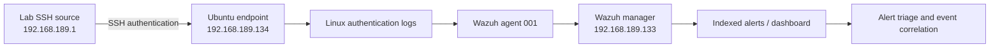

# SSH Brute-Force Detection and Investigation | Wazuh SIEM

    

## Project Overview

This project demonstrates a SOC analyst investigation of repeated SSH authentication failures in an authorized VMware home lab. I used Wazuh to monitor an Ubuntu endpoint, identify a correlated brute-force alert, pivot on the source IP address, compare SIEM events against Linux authentication logs, and assess a subsequent authentication-success correlation.

The objective was to practice the end-to-end investigation workflow rather than simply install a SIEM. The activity was simulated against my own lab endpoint; no external systems were targeted.

## Executive Summary

| Item | Finding |
| --- | --- |
| Incident date | November 25, 2026 |
| Incident type | SSH brute-force / repeated password failures |
| Affected endpoint | `SOC-Ubuntu-01` |
| Source IP | `192.168.189.1` (private lab address) |
| Destination IP | `192.168.189.134` |
| Targeted account | `socadmin` |
| Primary detection | Rule `5763`, level `10` |
| Subsequent correlation | Rule `40112`, level `12`, two indexed alerts |
| MITRE ATT&CK | Credential Access — T1110 (Brute Force) |
| SSH-filtered results | 16 indexed alert documents |
| Classification | True positive — authorized lab simulation |
| Investigation status | Detection validated; successful-login details pending verification |

**Key finding:** Wazuh detected repeated failed SSH authentication, followed by two higher-level alerts reporting multiple authentication failures followed by a success. The underlying successful authentication method and account have not yet been independently verified. The evidence does not establish unauthorized access or compromise.

## Lab Environment

| Component | Configuration |
| --- | --- |
| Virtualization | VMware Workstation |
| SIEM manager | `wazuh-server-01` — `192.168.189.133` |
| Dashboard access | HTTPS, port `443` |
| Monitored endpoint | `SOC-Ubuntu-01` — `192.168.189.134` |
| Agent ID | `001` |
| Endpoint OS | Ubuntu 26.04.1 LTS (as reported by Wazuh) |
| Wazuh agent version | `4.14.10` |
| Agent group | `default` |
| Authentication log sources | Linux `journald` and `/var/log/auth.log` |
| Investigation interface | Wazuh Threat Hunting / Events (DQL) |



## Investigation Methodology and Evidence

### 1. Verify endpoint monitoring

I confirmed that Wazuh agent `001` was registered and active before analyzing the simulation. The Endpoints dashboard displayed one active agent and no disconnected, pending, or never-connected agents.


*Evidence 01 — active Ubuntu agent, IP address, operating system, and Wazuh version.*

### 2. Verify Linux authentication logging

I inspected the endpoint's Wazuh configuration and authentication log. The configuration displayed a `journald` log input, while `/var/log/auth.log` contained local authentication and sudo activity.

Commands used to inspect the endpoint:

```bash
sudo systemctl status wazuh-agent
sudo grep -n -A 4 -B 2 -E 'auth.log|journald' /var/ossec/etc/ossec.conf
sudo tail -n 20 /var/log/auth.log
```


*Evidence 02 — Linux authentication log and Wazuh log-collection configuration.*

### 3. Generate and verify controlled SSH authentication failures

I performed repeated unsuccessful SSH password authentication attempts against the lab account `socadmin`. I then inspected the endpoint log to confirm that SSH recorded the source IP, target username, and authentication failures.

```bash
sudo grep 'Failed password' /var/log/auth.log | tail -n 20
```


*Evidence 03 — six visible SSH failed-password entries, all originating from `192.168.189.1`, between 13:37:17 and 13:38:19 UTC. The additional sudo command audit entry is not an SSH failure.*

Example observed log entry (fractional timestamp omitted):

```text
2026-11-25T13:37:17+00:00 soc-ubuntu-01 sshd-session[3131]: Failed password for socadmin from 192.168.189.1 port 60004 ssh2
```

### 4. Review the SIEM threat-hunting dashboard

I accessed the Wazuh Threat Hunting dashboard to review alert volume, authentication activity, and MITRE ATT&CK mappings.

| Dashboard metric | Observed value |
| --- | ---: |
| Total alerts | 91 |
| Level 12 or above | 2 |
| Authentication failure | 32 |
| Authentication success | 15 |


*Evidence 04 — broad 30-minute dashboard overview. These totals include other lab activity and are not incident-specific counts.*

### 5. Triage the brute-force detection

The initial rule-ID query returned no results because it omitted the rule actually triggered in my environment. I broadened the query to `rule.groups:sshd`, expanded the matching event, and confirmed rule `5763` in the alert document.

Corrected DQL filter:

```text
agent.name:"SOC-Ubuntu-01" AND rule.id:"5763"
```

| Alert field | Observed value |
| --- | --- |
| `timestamp` | Nov 25, 2026, 21:37:42.428 (dashboard time) |
| `agent.id` | `001` |
| `agent.ip` | `192.168.189.134` |
| `data.srcip` | `192.168.189.1` |
| `data.dstuser` | `socadmin` |
| `data.srcport` | `57908` |
| `decoder.name` | `sshd` |
| `location` | `journald` |
| `rule.id` | `5763` |
| `rule.level` | `10` |
| `rule.frequency` | `8` |
| `rule.firedtimes` | `1` |
| `rule.groups` | `syslog`, `sshd`, `authentication_failures` |
| `rule.mitre.id` | `T1110` |

**Rule description:** `sshd: brute force trying to get access to the system. Authentication failed.`


*Evidence 05 — full alert document, decoded fields, previous log output, rule metadata, and MITRE ATT&CK mapping.*

The `previous_output` field contains earlier failed authentication messages. The frequency value is a rule parameter; it should not be reported as the exact count of unique password attempts during the incident.

### 6. Pivot on the source IP address

I expanded the investigation beyond the original rule ID to identify other events associated with the same endpoint and source IP.

```text
agent.name:"SOC-Ubuntu-01" AND data.srcip:"192.168.189.1"
```


*Evidence 06 — source-IP correlation showing authentication failures, connection resets, brute-force detection, and subsequent level-12 success-correlation alerts.*

| Rule ID | Level | Observed description |
| --- | ---: | --- |
| `5760` | 5 | sshd: authentication failed. |
| `5503` | 5 | PAM: User login failed. |
| `5762` | 4 | sshd: connection reset |
| `2502` | 10 | syslog: User missed the password more than one time |
| `5763` | 10 | sshd: brute force trying to get access to the system. Authentication failed. |
| `40112` | 12 | Multiple authentication failures followed by a success. |

The two `40112` alerts are important escalation indicators. Their descriptions warrant further investigation of the underlying login event; they do not, by themselves, prove that an attacker obtained access. They may also represent overlapping correlation alerts rather than two distinct successful logins.

### 7. Correlate SSH events and build the incident timeline

I narrowed the investigation to SSH-related activity from the identified source.

```text
agent.name:"SOC-Ubuntu-01" AND data.srcip:"192.168.189.1" AND rule.groups:sshd
```


*Evidence 07 — 16 matching SSH alert documents, including authentication failures, connection resets, and the brute-force correlation.*

| Rule ID | Count in SSH-filtered view |
| --- | ---: |
| `5760` — authentication failed | 11 |
| `5762` — connection reset | 4 |
| `5763` — brute-force detection | 1 |
| **Total** | **16** |

Indexed alert counts are not equivalent to unique authentication attempts. The endpoint log shows six visible failed-password entries, while the dashboard includes multiple closely spaced alerts. The exact reason for the apparent overlap has not been verified.

#### Incident timeline

Dashboard timestamps are shown in UTC+8, inferred by comparing the corresponding UTC endpoint log entry with the dashboard alert.

| Time (UTC+8) | Event | Evidence |
| --- | --- | --- |
| 21:37:17 | Earliest failed password visible in the supplied log | Endpoint log / rule 5760 |
| 21:37:22–21:37:28 | Repeated SSH authentication failures | Rule 5760 / endpoint log |
| 21:37:30 | Connection-reset and repeated-password-miss alerts | Rules 5762, 2502 |
| 21:37:42.428 | Brute-force correlation triggered | Rule 5763, level 10 |
| 21:37:49–21:38:20 | Further indexed authentication failures | Rule 5760 |
| 21:38:21–21:38:22 | Additional connection-reset and password-miss alerts | Rules 5762, 2502 |
| 21:38:25.380 | Failure-followed-by-success correlation | Rule 40112, level 12 |
| 21:38:26.438 | Second failure-followed-by-success correlation | Rule 40112, level 12 |

## MITRE ATT&CK Mapping

| Tactic | Technique | Evidence |
| --- | --- | --- |
| Credential Access | [T1110 — Brute Force](https://attack.mitre.org/techniques/T1110/) | Wazuh rule 5763 maps to T1110; repeated failed SSH passwords support this mapping. |

## Investigation Findings and Impact Assessment

- The monitored endpoint was active and successfully generated indexed SSH alerts.
- Repeated failed password authentication targeted `socadmin` from the private lab IP `192.168.189.1`.
- Wazuh correlated this activity into one level-10 brute-force alert (rule `5763`).
- A broader source-IP search revealed two level-12 failure-followed-by-success alerts (rule `40112`). These were not included in the SSH-only results shown in evidence 07.
- The narrower exported threat-hunting report contains one rule-5763 alert, one authentication failure, and zero authentication successes under its selected filters. This does not contradict the broader source-IP view, because the report filters exclude rule `40112` and other event types.
- The observed brute-force activity is a true positive for the authorized simulation. Unauthorized access, privilege escalation, persistence, or data exposure has not been established by the collected evidence.

### Follow-up verification — pending

To determine whether the later correlation corresponds to an actual successful SSH login, I would expand both rule `40112` alert documents, inspect their `full_log`, `previous_output`, account and decoder fields, then compare them with the endpoint's original logs during the incident window.

DQL query for follow-up:

```text
agent.name:"SOC-Ubuntu-01" AND data.srcip:"192.168.189.1" AND rule.id:"40112"
```

Read-only endpoint verification commands (not yet documented as executed):

```bash
sudo journalctl --utc --since '2026-11-25 13:35:00 UTC' \
  --until '2026-11-25 13:45:00 UTC' --no-pager | \
  grep -E 'sshd(-session)?\[[0-9]+\]: (Accepted|Failed|Invalid user)'

sudo grep -E 'sshd(-session)?\[[0-9]+\]: Accepted ' /var/log/auth.log | \
  grep '192\.168\.189\.1'
```

If a matching successful SSH login is confirmed, verify whether it was an intentional lab login, its authentication method, account, and associated session activity. Until then, the login outcome remains pending and the incident should not be described as fully contained or closed.

## Recommended Response and Hardening

The following are proposed actions, not remediation claimed to have been implemented in this project.

| Priority | Recommendation |
| --- | --- |
| High | Validate the success-correlation alerts and determine whether the login was authorized. |
| High | Use SSH public-key authentication and disable password authentication where operationally appropriate, after verifying alternative access. |
| High | Restrict SSH exposure to authorized management networks or trusted source IPs. |
| Medium | Consider authentication rate limiting and carefully tested temporary IP blocking. |
| Medium | Review logging for potential duplicate ingestion and validate detection correlation behavior. |
| Medium | Monitor repeated failures followed by successful login and escalate according to incident response procedures. |

In a production environment, containment decisions should be based on validated evidence, operational impact, and the applicable response playbook.

## Exported Threat Hunting Report

[View the Wazuh-generated PDF report](reports/wazuh-module-agents-001-general-1795614425.pdf)

The six-page report covers November 25, 2026, 21:31:54–21:46:54 (as displayed). Page 1 records the endpoint and report filter, page 4 displays the filtered totals, page 5 confirms one level-10 rule-5763 alert, and page 6 lists its authentication-failure, SSH, and syslog groups. This report is scoped to the brute-force detection and is not a complete record of all subsequent authentication events.

## Skills Demonstrated

- SIEM monitoring and endpoint visibility using Wazuh
- Linux authentication log validation and analysis
- Alert triage and rule identification
- DQL search, filtering, and troubleshooting
- Source-IP correlation and incident timeline reconstruction
- MITRE ATT&CK mapping and risk assessment
- Evidence collection, incident reporting, and response recommendations

## Project Structure

```text
SSH-Brute-Force-Detection/
├── README.md
├── screenshots/
│   ├── 01-wazuh-agent-active.png
│   ├── 02-authentication-log-verification.png
│   ├── 03-failed-ssh-authentication.png
│   ├── 04-wazuh-threat-hunting.png
│   ├── 05-alert-details.png
│   ├── 06-source-ip-analysis.png
│   └── 07-investigation-findings.png
└── reports/
    └── wazuh-module-agents-001-general-1795614425.pdf
```

## Conclusion

This investigation validated Wazuh's ability to detect and correlate repeated SSH authentication failures in a controlled environment. Pivoting from the initial brute-force alert to the broader source-IP activity revealed additional higher-severity indicators that would have been missed by a narrow rule filter. The project demonstrates a practical SOC workflow: verify telemetry, triage the alert, correlate supporting evidence, assess impact without overstating conclusions, and identify the next investigative action.

> **Ethical scope:** All activity was conducted within an authorized private home lab for defensive cybersecurity education. The IP addresses and account shown are lab-specific identifiers.
