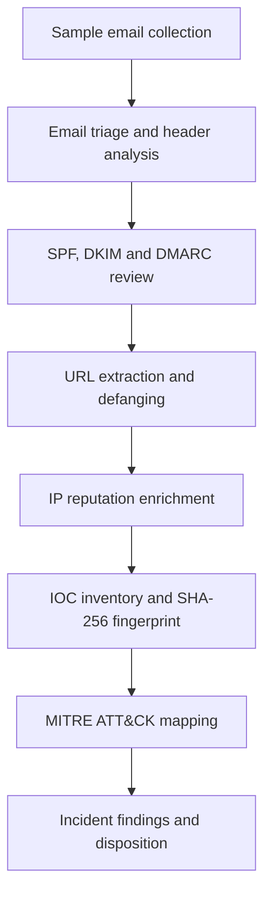
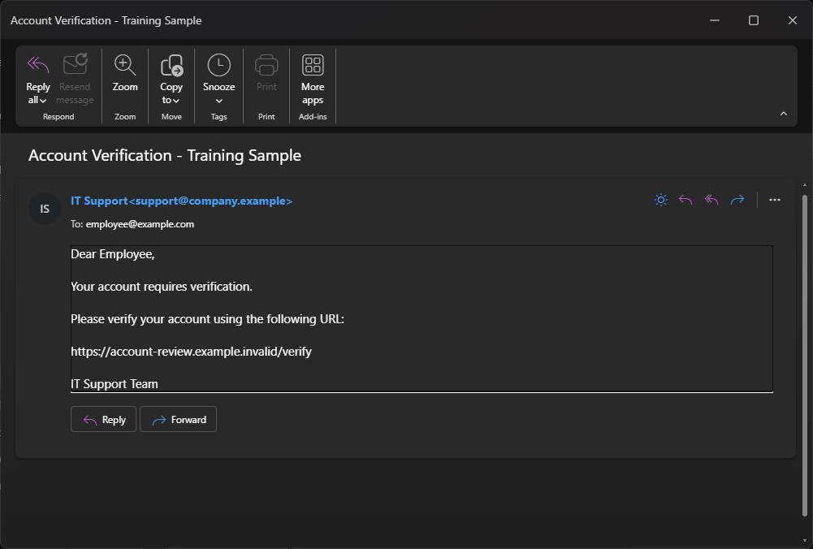
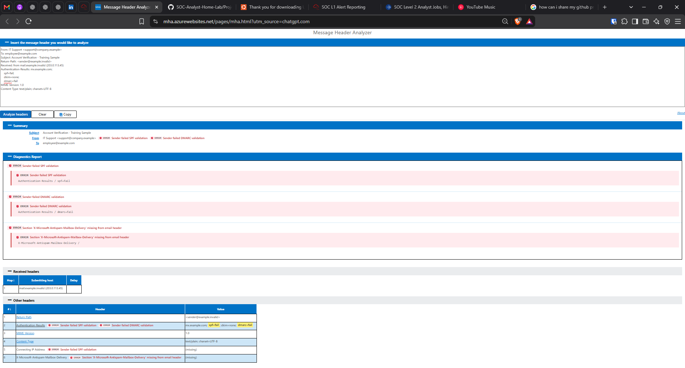
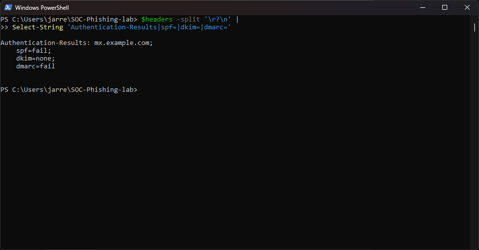
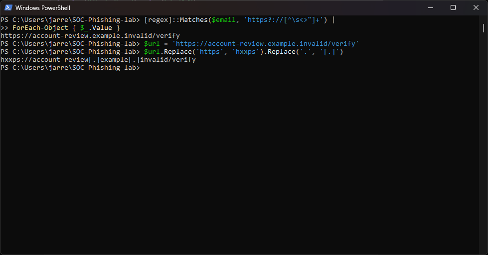
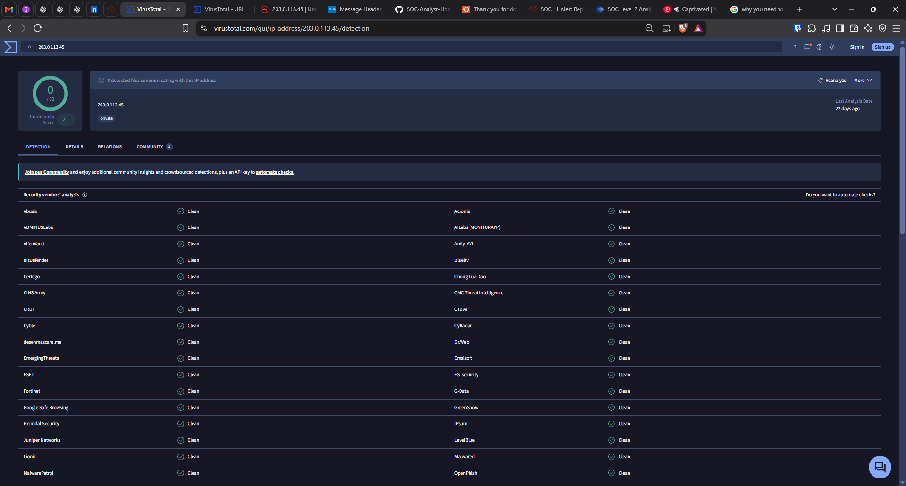
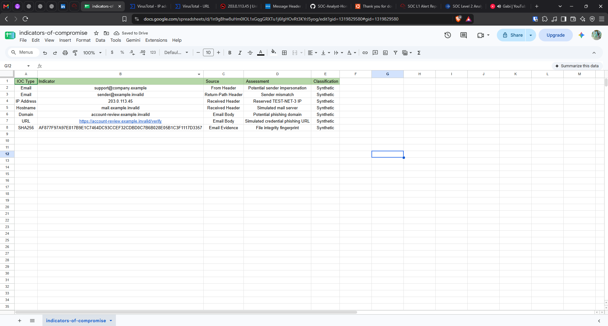
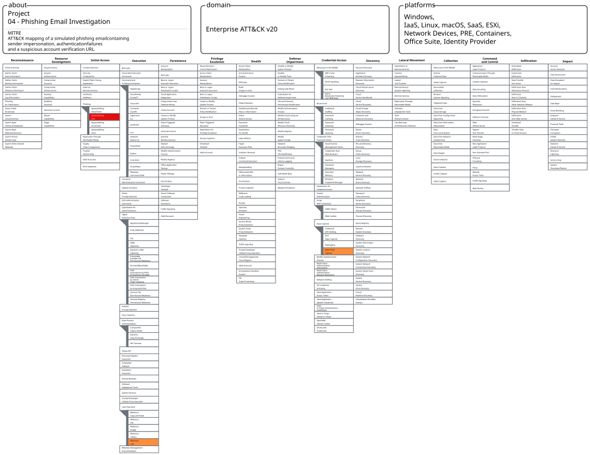

# Project 04 — Phishing Email Investigation


## Executive Summary

This project simulates the investigation of a suspicious account verification email from the perspective of a Security Operations Center (SOC) analyst. The investigation covers email triage, header analysis, email authentication review, URL extraction and defanging, IP reputation enrichment, indicator documentation, MITRE ATT&CK mapping, and incident reporting.

The sample impersonates an IT Support team and attempts to persuade the recipient to visit an account verification URL. The supplied headers contain SPF and DMARC failures, no reported DKIM signature, and a mismatch between the visible sender and Return-Path.

**Final verdict:** Simulated credential phishing attempt. No real-world compromise was established. All email infrastructure and indicators in this exercise are synthetic; no actual malicious website or victim interaction was demonstrated.

## 1. Incident Overview

| Field | Details |
|---|---|
| Incident ID | PHISH-001 |
| Incident type | Phishing email |
| Environment | SOC home lab — controlled simulation |
| Subject | Account Verification - Training Sample |
| Classification | Simulated credential phishing |
| Severity | Medium (exercise rating) |
| Status | Closed — investigation completed |
| Observed impact | None demonstrated; no live incident or victim telemetry |

## 2. Objectives and Tools

The objective was to practice an evidence-driven SOC investigation from initial triage to a documented disposition, while distinguishing suspicious indicators from confirmed compromise.

| Tool | Purpose |
|---|---|
| Windows PowerShell | Header extraction, authentication review, URL extraction and defanging, SHA-256 hashing |
| Microsoft Outlook | Inspect the sample email as presented to a recipient |
| Microsoft Message Header Analyzer (MHA) | Parse email headers and review supplied authentication results |
| VirusTotal | IP address reputation enrichment |
| Google Sheets | Review and organize the indicator inventory |
| MITRE ATT&CK Navigator | Map the simulated behavior to relevant techniques |
| Google Docs | Document the investigation findings and recommendations |
| GitHub | Publish the sanitized investigation evidence and portfolio documentation |

## 3. Investigation Workflow



## 4. Investigation and Evidence

### 4.1 — Sample Email and Initial Triage

A synthetic `.eml` file was created and inspected in Outlook. The message claims to originate from IT Support, requests account verification, and directs the recipient to an external-looking URL. These characteristics are consistent with a social engineering lure. The message uses a generic greeting and provides no independently verifiable account context.

| Field | Extracted value |
|---|---|
| From | `IT Support <support@company.example>` |
| To | `employee@example.com` |
| Subject | Account Verification - Training Sample |
| Return-Path | `sender@example.invalid` |
| URL (defanged) | `hxxps://account-review[.]example[.]invalid/verify` |



*Figure 1 — Synthetic phishing email viewed in Outlook.*

### 4.2 — Email Header Analysis

The extracted headers were inspected using Microsoft Message Header Analyzer. The analyzer identified the supplied SPF and DMARC failures and displayed the sending host and Return-Path.

| Header | Finding | Analyst interpretation |
|---|---|---|
| From | `support@company.example` | Claimed IT Support identity |
| Return-Path | `sender@example.invalid` | Different domain from the visible sender; investigate possible impersonation |
| Received | `mail.example.invalid (203.0.113.45)` | Simulated sending host and IP |
| Authentication-Results | `spf=fail; dkim=none; dmarc=fail` | Supplied results indicate authentication problems |
| Content-Type | `text/plain; charset=UTF-8` | Plain-text message |

A Return-Path mismatch alone does not prove spoofing; legitimate mail services may also use different envelope sender domains. The missing Microsoft anti-spam mailbox delivery header is expected in this manually constructed sample and is not independent evidence of phishing.



*Figure 2 — Header parsing and authentication diagnostics.*

### 4.3 — Email Authentication Analysis

PowerShell was used to extract the authentication-related fields from the email headers.

```powershell
$email = Get-Content .\evidence\suspicious-email.eml -Raw
$headers = ($email -split '\r?\n\r?\n', 2)[0]
$headers -split '\r?\n' |
    Select-String 'Authentication-Results|spf=|dkim=|dmarc='
```

| Authentication mechanism | Reported result | Interpretation |
|---|---|---|
| SPF (Sender Policy Framework) | Fail | The supplied result reports a sender authorization failure |
| DKIM (DomainKeys Identified Mail) | None | No DKIM signature was reported |
| DMARC (Domain-based Message Authentication, Reporting and Conformance) | Fail | The supplied result reports a DMARC authentication failure |

These values were deliberately included in the synthetic headers. The exercise demonstrates extracting and interpreting authentication results, not independently validating a real message's DNS or cryptographic authentication.



*Figure 3 — SPF, DKIM and DMARC results extracted using PowerShell.*

### 4.4 — URL Extraction and Defanging

The account verification URL was extracted from the email body using a regular expression. The URL was then defanged for safe reporting and to prevent accidental navigation.

```powershell
[regex]::Matches($email, 'https?://[^\s<>"]+') |
    ForEach-Object { $_.Value }

$url = 'https://account-review.example.invalid/verify'
$url.Replace('https', 'hxxps').Replace('.', '[.]')
```

**Defanged indicator:** `hxxps://account-review[.]example[.]invalid/verify`

The account verification wording suggests a potential credential collection lure. However, `.invalid` is a reserved domain suffix, and no live phishing page, URL reputation verdict, credential collection form, or successful user interaction was established by this exercise.



*Figure 4 — Extracted URL and defanged representation.*

### 4.5 — IP Reputation Enrichment

The IP address extracted from the `Received` header was searched in VirusTotal using its dedicated IP address report.

| Attribute | Finding |
|---|---|
| IP address | `203.0.113.45` |
| VirusTotal detection score | 0/92 at the time of the captured report |
| Related-file notice | VirusTotal displayed 8 detected files communicating with the IP |
| Address range | `203.0.113.0/24` — TEST-NET-3 |
| Assessment | Reserved documentation address; synthetic indicator |

The 0/92 score does not prove that an indicator is safe. The related-file notice also does not establish a connection to this simulated email. The address is reserved for documentation under RFC 5737 and should not be treated as a confirmed attacker IP or a production blocking target.



*Figure 5 — VirusTotal IP reputation results for the simulated source address.*

### 4.6 — Indicators of Compromise (IOC) Extraction

The extracted indicators were consolidated into a CSV inventory, recording their type, source, assessment and synthetic classification. The file was reviewed in Google Sheets.

| Type | Indicator | Source / assessment |
|---|---|---|
| Email | `support@company.example` | From header; potential sender impersonation |
| Email | `sender@example.invalid` | Return-Path; sender mismatch |
| IPv4 | `203.0.113.45` | Received header; reserved TEST-NET-3 address |
| Hostname | `mail.example.invalid` | Received header; simulated mail server |
| Domain | `account-review.example.invalid` | Email body; simulated phishing domain |
| URL | `hxxps://account-review[.]example[.]invalid/verify` | Email body; defanged account verification link |
| SHA-256 | See fingerprint below | Original email sample; evidence integrity fingerprint |

**SHA-256 evidence fingerprint** (as recorded in the IOC spreadsheet):

```text
AF877F97A97E817B9E1C7464DC93CCEF32CDBD0C7B6B028E05B1C3F1117D3357
```

The hash identifies the specific file contents; it is not a malware verdict. It can be recalculated from the original `.eml` file for integrity verification:

```powershell
Get-FileHash .\evidence\suspicious-email.eml -Algorithm SHA256
```

**Deliverable:** [indicators-of-compromise.csv](reports/indicators-of-compromise.csv)



*Figure 6 — Seven synthetic indicators and their investigation context.*

### 4.7 — MITRE ATT&CK Mapping

The scenario was mapped using MITRE ATT&CK Navigator (Enterprise ATT&CK v20, as shown in the exported layer). The primary technique is highlighted in red, and potential follow-on techniques are highlighted in orange.

| Tactic | Technique | Assessment |
|---|---|---|
| Initial Access | [T1566.002 — Spearphishing Link](https://attack.mitre.org/techniques/T1566/002/) | Primary scenario mapping: email containing a deceptive link |
| Execution | [T1204.001 — Malicious Link](https://attack.mitre.org/techniques/T1204/001/) | Hypothetical follow-on; no click or execution observed |
| Credential Access | [T1056.003 — Web Portal Capture](https://attack.mitre.org/techniques/T1056/003/) | Hypothetical follow-on; no portal or credential capture observed |

If the objective were credential collection for reconnaissance rather than initial access, [T1598.003 — Spearphishing Link (Phishing for Information)](https://attack.mitre.org/techniques/T1598/003/) would also merit consideration. The email alone does not establish an adversary's actual objective; this alternative was not highlighted in the exported layer.



*Figure 7 — Exported ATT&CK Navigator layer distinguishing the primary simulated technique from hypothetical follow-on behavior.*

## 5. Final Investigation Findings

| Finding | Result |
|---|---|
| Claimed sender identity | IT Support impersonation scenario |
| Sender and Return-Path | Domain mismatch identified |
| SPF / DKIM / DMARC | Fail / None / Fail (synthetic header values) |
| Suspicious link | Extracted and defanged |
| IP reputation | 0/92 detections reported; reserved documentation address |
| IOC inventory | Seven entries recorded, including evidence hash |
| MITRE ATT&CK | Primary scenario technique and two hypothetical follow-on techniques mapped |
| User interaction or endpoint compromise | Not observed or demonstrated |

**Analyst verdict:** The evidence is consistent with a simulated credential phishing attempt based on the deceptive account verification request, sender identity mismatch, and deliberately supplied authentication failures. No real-world compromise was established. The exercise was closed following documentation of the findings.

.png)

*Figure 8 — Final SOC incident findings and recommended remediation report.*

## 6. Recommended Response Actions

For an equivalent real-world incident, the following actions would be considered according to organizational policy and verified evidence:

1. **Containment:** Quarantine the suspicious message and identify other recipients through mail logs.
2. **Scope assessment:** Review mail gateway, proxy, DNS, identity and endpoint telemetry for signs of interaction or compromise.
3. **Threat enrichment:** Validate suspicious indicators and block confirmed malicious infrastructure where appropriate.
4. **Account protection:** If credentials were exposed, reset affected credentials, revoke active sessions and investigate unusual authentication activity.
5. **Recovery and prevention:** Confirm containment, review email authentication controls and deliver targeted phishing awareness guidance.
6. **Documentation:** Record evidence, decisions, escalation rationale and final incident disposition.

These are recommendations, not actions performed against a production environment during this lab.

## 7. Evidence Handling and Limitations

- The original `.eml` is the source evidence; the extracted header text is a separate analysis copy.
- Email addresses, hostnames, domains and IP addresses in the sample are reserved or fictional. No actual customer or employee email content was used.
- The `email-header-redacted.txt` file is a header-only, privacy-safe copy; no additional redaction is necessary for this synthetic sample.
- The reported email authentication outcomes are simulated, not live authentication checks.
- The captured VirusTotal result is a point-in-time observation and does not establish a malicious or benign verdict by itself.
- No actual delivery to a target, user click, credential submission, endpoint compromise or production remediation was demonstrated.
- The hash is transcribed from the captured spreadsheet; it should be verified against the original file before relying on it for evidence integrity.

## 8. Repository Structure

```text
Project-04-Phishing-Email-Investigation/
├── README.md
├── evidence/
│   ├── suspicious-email.eml
│   └── email-header-redacted.txt
├── reports/
│   └── indicators-of-compromise.csv
└── screenshots/
    ├── 01-sample-phishing-email.png.png
    ├── 02-email-header-analysis.png
    ├── 03-email-authentication.png
    ├── 04-url-analysis.png
    ├── 05-ip-reputation.png
    ├── 06-ioc-extraction.png
    ├── 06-mitre-attack-mapping.png.svg
    └── 07-investigation-findings(1).png
```

The screenshot paths match the captured evidence filenames. The evidence and CSV files are intended companion deliverables and should be uploaded to the indicated folders. The full written incident report and Navigator JSON layer can also be included if exported separately.

## 9. Skills Demonstrated

- SOC alert triage and phishing email investigation
- Email header interpretation and authentication analysis (SPF, DKIM, DMARC)
- PowerShell-based evidence extraction and URL defanging
- Threat intelligence enrichment and contextual IP reputation assessment
- Structured IOC documentation and evidence integrity verification using SHA-256
- MITRE ATT&CK technique mapping and differentiation of observed versus hypothetical behavior
- Incident classification, remediation recommendations and clear technical reporting

## 10. References

- [Microsoft Message Header Analyzer](https://mha.azurewebsites.net/)
- [VirusTotal — IP address report](https://www.virustotal.com/gui/ip-address/203.0.113.45)
- [MITRE ATT&CK Navigator](https://mitre-attack.github.io/attack-navigator/)
- [MITRE ATT&CK Enterprise Matrix](https://attack.mitre.org/matrices/enterprise/)
- [RFC 5737 — IPv4 Address Blocks Reserved for Documentation](https://www.rfc-editor.org/rfc/rfc5737)
- [RFC 2606 — Reserved Top Level DNS Names](https://www.rfc-editor.org/rfc/rfc2606)

---

*Educational cybersecurity home lab project. All investigation activities were based on synthetic evidence and intended for defensive security training.*
